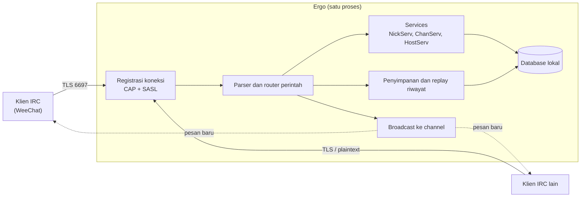
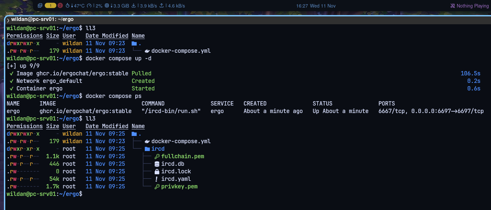
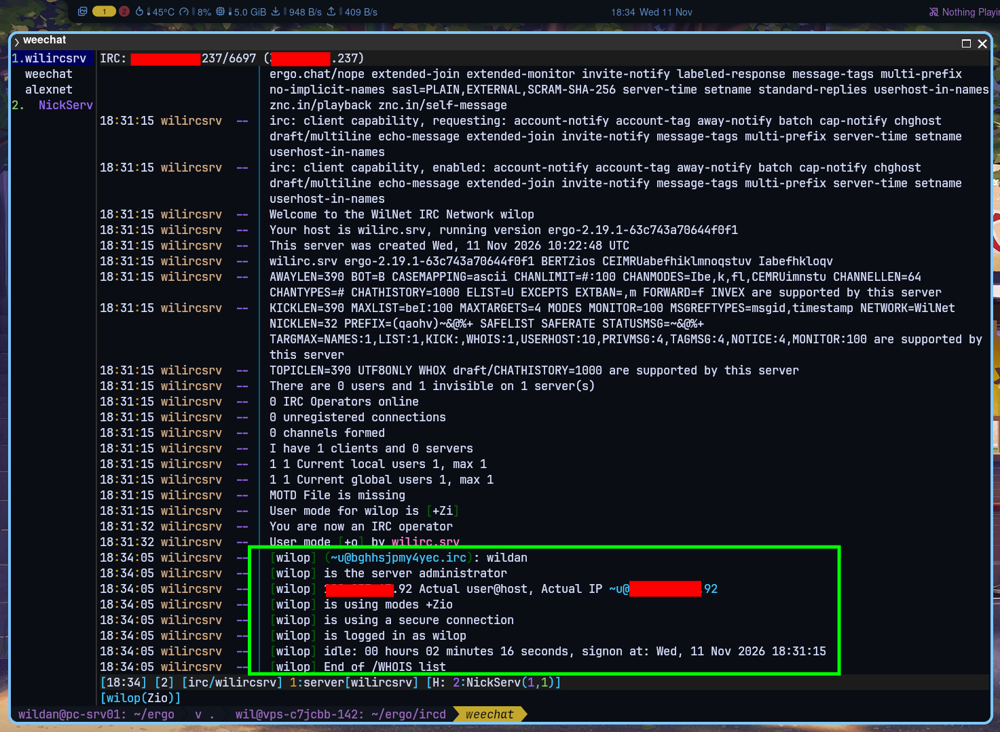
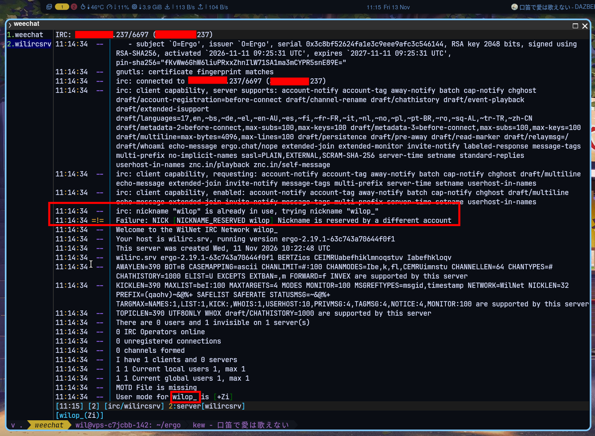
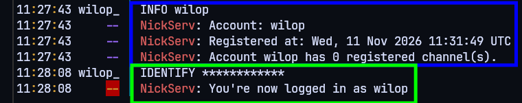
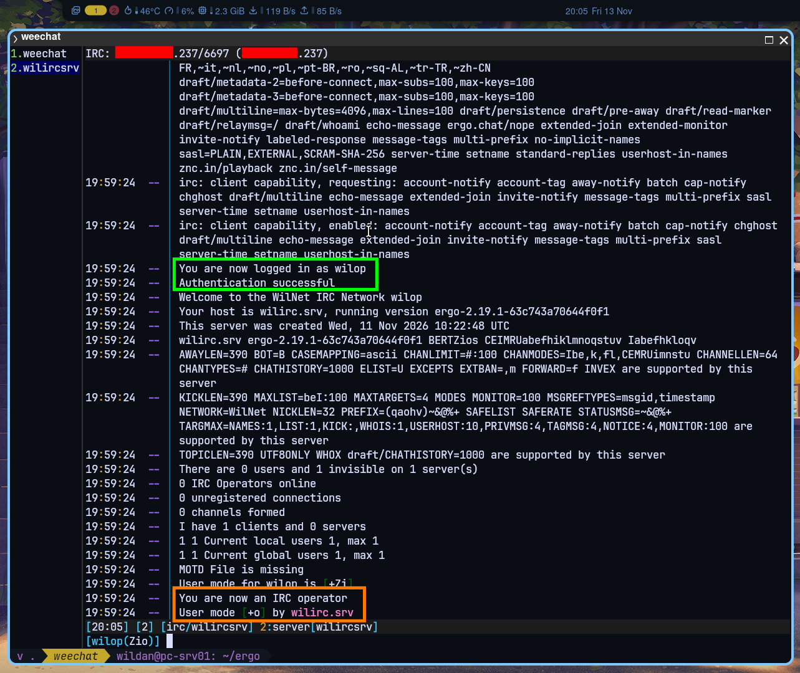
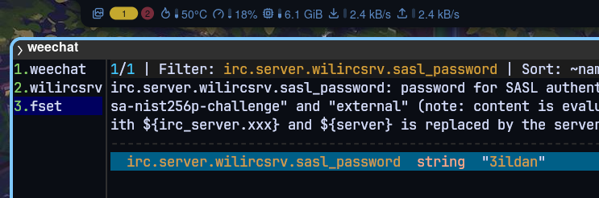

:::warning[AI Usage]

Some of these article contents are AI-assisted (Opencode with DeepSeek V4.1 Flash Free and Antrophic Claude).

:::

## About Ergo

**Ergo** (dulu bernama **Oragono**) adalah server IRC modern — sering disebut *ircd* atau *IRC daemon* — yang ditulis dengan bahasa Go dan dirilis di bawah lisensi MIT. Berbeda dari ircd klasik, Ergo menggabungkan tiga peran sekaligus dalam satu proses: server IRC, kumpulan layanan terintegrasi (NickServ, ChanServ, HostServ), dan fungsionalitas *bouncer* (menyimpan serta memutar ulang riwayat pesan, sekaligus memungkinkan beberapa klien memakai nickname yang sama).[^1]

Beberapa keunggulan yang ditonjolkan proyek ini:[^2]

- Dukungan IRCv3 yang lengkap sehingga layak dijadikan referensi implementasi.
- TLS/SSL native, termasuk dukungan client certificate, serta autentikasi SASL.
- Konfigurasi YAML yang bisa di-*rehash* (dimuat ulang saat server berjalan) tanpa restart.
- Fitur keamanan dan privasi: cloaking IP, kewajiban SASL untuk semua login, hingga dukungan Tor hidden service.
- Password disimpan dengan bcrypt, mendukung LDAP lewat plugin, dan tersedia dalam berbagai bahasa.
- Ringan dan mudah dijalankan: cukup satu binary, atau satu container Docker seperti pada artikel ini.

Karena itu Ergo cocok dipakai untuk komunitas kecil maupun jaringan IRC pribadi yang ingin fitur modern tanpa harus merakit ircd + services + bouncer secara terpisah.[^3]

### How It Works

Secara garis besar, Ergo adalah satu proses yang membuka port IRC, menyimpan seluruh status jaringan di database lokal, dan menjalankan layanan (services) sebagai klien virtual di dalam proses yang sama. Alurnya kurang lebih seperti ini:[^4]

1. **Koneksi dan registrasi.** Klien terhubung lewat TLS (port 6697) atau plaintext (port 6667). Setelah itu terjadi negosiasi `CAP` untuk mengaktifkan kapabilitas IRCv3, lalu autentikasi SASL (`PLAIN`, atau `EXTERNAL` dengan client certificate). Jika autentikasi akun berhasil, nickname langsung terikat ke akun tersebut (*nick = account*).
2. **Parsing dan routing.** Perintah IRC (`JOIN`, `PRIVMSG`, `MODE`, dan sebagainya) diurai lalu dirutekan: apakah tujuannya channel, pengguna lain, atau layanan seperti `NickServ`.
3. **Layanan terintegrasi.** NickServ mengelola pendaftaran akun, ChanServ mengelola pendaftaran channel beserta topik dan mode-nya, sedangkan HostServ mengatur *vanity host*. Karena semuanya berjalan di dalam proses Ergo, tidak perlu server services terpisah seperti pada jaringan IRC tradisional.
4. **Broadcast dan riwayat.** Pesan ke channel diteruskan ke seluruh anggotanya. Ergo juga menyimpan riwayat pesan: klien yang mendukung `chathistory` bisa meminta pesan lama, dan beberapa klien dapat login ke nickname yang sama secara bersamaan layaknya memakai bouncer.
5. **Penyimpanan.** Akun, channel, dan riwayat pesan disimpan di database lokal yang ditentukan pada konfigurasi, sehingga tetap ada setelah server di-restart.
6. **Konfigurasi.** Semua pengaturan dibaca dari `ircd.yaml`; perubahan dapat diterapkan lewat `REHASH` tanpa mematikan server.



Dengan model ini, Ergo terasa seperti ircd biasa bagi klien lama, tetapi sudah membawa akun, riwayat, dan multi-klien sejak awal — tanpa komponen tambahan.

:::note

Saya juga pernah menulis tentang cara _setup_ IRC Daemon dengan `inspircd` & `ircd-hybrid`:

[[tech/ircserver]]

:::

## Requirements

Beberapa persiapan yang diperlukan agar IRC Server kita dapat diakses secara publik:

1. Sebuah VPS (_Virtual Private Server_): 1 vcpu, 1 GB ram, 15-20 GB storage.
2. Pengetahuan dasar tentang model jaringan "Server-Client".
3. Pengetahuan dasar tentang perintah-perintah Linux.
4. Pengetahuan dasar tentang Docker & Docker Compose.

> Persyaratan nomor 3 & 4 tetap akan relevan dan membantu walaupun kalian menggunakan AI untuk melakukan _setup_ `ergo`.

Kenapa pengetahuan tentang Docker & Docker Compose diperlukan? Tentu saja, karena kita akan men-_deploy_ `ergo` via Docker Compose.

:::note


Saya juga pernah menulis tentang Docker, Docker Compose dan Lazydocker:

[[tech/docker]]

:::

## Installation

Dua hal yang perlu kita pasang

### 1. Docker Engine Installation

Berikut adalah langkah-langkah instalasi Docker berdasarkan web resmi Docker:[^5]

:::note

Instalasi Docker ini saya asumsikan dilakukan di server Ubuntu 24.04 (karena VPS saya Ubuntu). Silakan kunjungi website Docker untuk melihat panduan instalasi Docker di OS lainnya.

:::

#### Uninstall Old Version

Beberapa paket Docker yang "_unofficial_" alias tidak resmi:

- `docker.io`  
- `docker-compose`  
- `docker-compose-v2`  
- `docker-doc`  
- `docker-buildx`  
- `podman-docker`  

```shell
sudo apt remove $(dpkg --get-selections docker.io docker-compose docker-compose-v2 docker-doc docker-buildx podman-docker containerd runc | cut -f1)
```

Jika kita belum pernah meng-_install_ paket-paket di atas, `apt` mungkin akan memberitahukan bahwa tidak ada paket-paket tersebut yang ter-_install_.

#### Install via `apt` Repo

Ini adalah cara yang paling efektif menurut saya, karena kita akan menambahkan repo Docker ke repo yang ada di Server/VPS Ubuntu kita:

```shell
# Add Docker's official GPG key:
sudo apt update
sudo apt install ca-certificates curl
sudo install -m 0755 -d /etc/apt/keyrings
sudo curl -fsSL https://download.docker.com/linux/ubuntu/gpg -o /etc/apt/keyrings/docker.asc
sudo chmod a+r /etc/apt/keyrings/docker.asc

# Add the repository to Apt sources:
sudo tee /etc/apt/sources.list.d/docker.sources <<EOF
Types: deb
URIs: https://download.docker.com/linux/ubuntu
Suites: $(. /etc/os-release && echo "${UBUNTU_CODENAME:-$VERSION_CODENAME}")
Components: stable
Architectures: $(dpkg --print-architecture)
Signed-By: /etc/apt/keyrings/docker.asc
EOF

sudo apt update
```

:::info

Jalankan (copy-paste) langkah-langkah di atas berdasarkan _comment_-nya. Jadi, _copy-paste_ semua baris yang ada di bawah comment `# Add Docker's official GPG Key`, baru kemudian lanjut copy-paste semua perintah yang ada di bawah comment `# Add the repository to Apt sources`.

:::

#### Install the Docker Packages

Untuk meng-_install_ versi terbaru:

```shell
sudo apt install docker-ce docker-ce-cli containerd.io docker-buildx-plugin docker-compose-plugin
```

Untuk memverifikasi Docker sudah ter-_install_:

```shell
sudo docker run hello-world
```

:::note[Add Docker to Sudo Group]


Normalnya, kita memerlukan `sudo` setiap kali berintaraksi dengan Docker. Jika kita tidak menginginkan hal tersebut, kita bisa memasukkan user kita ke grup Docker:

```shell
sudo usermod -aG docker $USER
newgrp docker # menerapkan perubahan di session saat ini (perintah ini tidak diperlukan jika kita memilih membuat session baru)
```

:::

### 2. Ergo 

Pertama, kita perlu membuat folder/direktori khusus untuk menyimpan file konfigurasi Docker Compose dan file-file lainnya.

```shell
mkdir ergo
cd ergo
```

Kemudian, di dalam direktori `ergo` tersebut, buat file `docker-compose.yaml`. Berikut adalah isi file Docker Compose `ergo`:

```yaml title="docker-compose.yml"
services:
  ergo:
    image: ghcr.io/ergochat/ergo:stable
    container_name: ergo
    restart: unless-stopped
    ports:
      - "6697:6697" 
    volumes:
      - ./ircd:/ircd
```

:::note[Keterangan]

1. Kita akan mengambil **image** `ergo` dari `ghcr.io/ergochat/ergo:stable` 
2. Nama Container-nya adalah **ergo** 
3. Container ini akan _restart_ jika dimatikan/dihentikan (_stopped_) 
4. Port forwarding dari Docker ke VPS -> `<port vps>`:`<port docker>` 
5. Media penyimpanan (file config, database, private keys, dkk) ada di direktori `./ircd`

:::

> Perhatikan! Jika VPS kalian menggunakan NAT, maka ganti bagian `<port VPS>` itu dengan port yang disediakan oleh provider VPS kalian, sebab, 6697 adalah port default IRC. 

Untuk mengunduh dan men-setup `ergo` via Docker Compose, jalankan perintah:

```shell
docker compose up -d
```

Setelah dijalankan, Ergo akan membuat file `ircd.yaml` dan `icrd.db` di folder `./ircd`.

Berikut kira-kira struktur direktorinya:



## Setup 

### 1. Ergo Daemon

Untuk melakukan setup Ergo, kita akan "mengutak-atik" file konfigurasinya: `ircd.yaml`.  
Masuk ke direktori `ircd` dan buka file `ircd.yaml`:

```shell
cd ircd
nvim ircd.yaml
```

#### Network & Server Name

Ubah `network.name` dan `server.name` ke nama jaringan dan domain (kalau ada). Kalau gak punya domain, kita bisa isi apapun. Ini hanya nama.

> Pastikan nama server di `server.name` ada titiknya. Misalnya, gw memberi nama `wilirc.srv`.

#### Generate Opers Pass

Sekarang, kita perlu men-_generate_ password untuk **opers** (Operator IRC Server):

```shell
docker compose exec ergo /ircd-bin/ergo genpasswd
```

Masukkan password, dan nanti akan muncul hash bcrypt-nya.

Setelah itu, ganti password default oper di `ircd.yaml` dengan hash yang baru saja kita buat.

#### Listeners

Pastikan `listeners` TLS-nya `":6697"` dan bukan `"127.0.0.1:6697"`. Sebab, kalau terkiat di `localhost`, nggak bisa diakses dari luar container. `listeners` plaintext 6667 sebaiknya dimatikan atau jangan di-_publish_.

Arahkan juga `cert` dan `key` ke file sertifikat kalian `fullchain.pem` & `privkey.pem`. Pastikan izinnya `read-only`.

#### Reload config/Docker

Kemudian, kita bisa me-_reload_ config atau cert-nya dengan perintah:

```shell
docker kill -s HUP ergo
```

Atau biar lebih utuh, kita restart Docker Compose-nya sekalian:

```shell
docker compose restart
docker compose logs --tail 30
```

Kira-kira, beginilah nanti bagian-bagian yang sudah kita ubah di `ircd.yaml`:

```yaml {4,9,39}
# network configuration
network:
    # name of the network
    name: WilNet

# server configuration
server:
    # server name
    name: wilirc.srv

...

# ircd operators
opers:
    # default operator named 'admin'; log in with /OPER admin <password>
    admin:
        # which capabilities this oper has access to
        class: "server-admin"

        # traditionally, operator status is visible to unprivileged users in
        # WHO and WHOIS responses. this can be disabled with 'hidden'.
        hidden: true

        # custom whois line (if `hidden` is enabled, visible only to other operators)
        whois-line: is the server administrator

        # custom hostname (ignored if `hidden` is enabled)
        #vhost: "staff"

        # modes are modes to auto-set upon opering-up. uncomment this to automatically
        # enable snomasks ("server notification masks" that alert you to server events;
        # see `/quote help snomasks` while opered-up for more information):
        #modes: +is acdjknoqtuxv

        # operators can be authenticated either by password (with the /OPER command),
        # or by certificate fingerprint, or both. if a password hash is set, then a
        # password is required to oper up (e.g., /OPER dan mypassword). to generate
        # the hash, use `ergo genpasswd`.
        password: "$2a$04$aS9cBP2jxCe/lG0uQadInO5Vlj9IdjK3np6eBvzJU1Rpl4QK9goim"
```

:::warning[About Docker iptables]

Docker menulis rute iptables sendiri, jadi port yand di-_publish_ bisa menembus `ufw`. Kalau kalian hanya ingin port-nya cuma terbuka di interface tertentu, tulis _mapping_-nya sebagai "IP_PUBLIK:PORT_NAT:6697".

:::

#### Verification

Untuk mem-verifikasi server IRC `ergo` sudah berjalan, jalankan perintah berikut di server (VPS):

```shell
openssl s_client -connect 127.0.0.1:6697 </dev/null 2>&1 | head -20
```

Server berhasil berjalan jika _output_-nya kurang lebih seperti ini:

```shell
Can't use SSL_get_servername
depth=0 O = Ergo
verify error:num=18:self-signed certificate
verify return:1
depth=0 O = Ergo
verify return:1
CONNECTED(00000003)
---
Certificate chain
 0 s:O = Ergo
   i:O = Ergo
   a:PKEY: rsaEncryption, 2048 (bit); sigalg: RSA-SHA256
   v:NotBefore: Nov 11 09:25:31 2026 GMT; NotAfter: Nov 11 09:25:31 2027 GMT
---
Server certificate
-----BEGIN CERTIFICATE-----
MIIDFjCCAf6gAwIBAgIQPIv1JiT6Hjye7pr8PFRhRDANBgkqhkiG9w0BAQsFADAP
MQ0wCwYDVQQKEwRFcmdvMB4XDTI2MTExMTA5MjUzMVoXDTI3MTExMTA5MjUzMVow
DzENMAsGA1UEChMERXJnbzCCASIwDQYJKoZIhvcNAQEBBQADggEPADCCAQoCggEB
AMkm78lVkqwf86yvhHM8y8gcu+MLS0PLIXDyJA3Qg1bfUonrVAdEMKeePqNrwA61
```

Di client, kita juga dapat menjalankan perintah berikut:

```shell
openssl s_client -connect <IP_PUBLIK>:6697 </dev/null 2>/dev/null | openssl x509 -noout -subject -fingerprint -sha256
```

Jika _output_-nya seperti ini, berarti Server IRC `ergo` sudah berjalan dan tugas kita tinggal men-_setting_ IRC Client:

```shell
subject=O=Ergo
sha256 Fingerprint=37:7A:D5:DE:D6:39:31:A7:6F:28:4A:66:D2:F5:E8:5F:5C:18:C2:E8:6F:86:7A:19:86:06:E1:10:08:54:AF:1A
```

:::info[Verifying Fingerprint]

Pastikan fingerprint yang muncul dari client sama dengan fingerprint yang ada di server (VPS). Untuk memastikannya, kita bisa menjalankan perintah berikut di server (VPS):

```shell
openssl x509 -in ~/ergo/ircd/fullchain.pem -noout -fingerprint -sha256
```

:::

### 2. Client (WeeChat)

Untuk software IRC client, saya menyarankan pakai [WeeChat](https://weechat.org/).

#### Installation

Berikut adalah instalasi `weechat` untuk beberapa sistem operasi:

::: code-group labels=[debian/ubuntu, archlinux, fedora, freebsd]

```shell
sudo apt install -y weechat
```

```shell
sudo pacman -Sy weechat
```

```shell
sudo dnf install weechat
```

```shell
sudo pkg install weechat
```

:::

> OpenSUSE belum punya _package_ `weechat` (setidaknya per artikel ini dibuat). Jadi, silakan compile langsung dari source code-nya di Github:

::github{repo="weechat/weechat"}

:::note

**NixOS:**  
Masukkan baris berikut di file konfigurasi (`/etc/nixos/configuration.nix`):

```nix title="nix"
environment.systemPackages = [
  pkgs.weechat
];
```

Atau jika menggunakan `nix-shell`:

```shell
nix-shell -p weechat
```

:::

#### Adding New Server

Sekarang, kita akan menambahkan server IRC baru kita tadi ke WeeChat.  
Masuk ke WeeChat:

```shell
weechat
```

Kemudian, tambahkan baris-baris berikut satu persatu:

```shell
# menambahkan server IRC 
/server add wilircsrv <IP_PUBLIK>/6697 -tls

# menonaktifkan verifikasi TLS
/set irc.server.wilircsrv.tls_verify off

# menambahkan TLS fingerprint
/set irc.server.wilircsrv.tls_fingerprint 377ad5ded63931a76f284a66d2f5e85f5c18c2e86f867a198606e1100854af1a

# menambahkan "nick" (nickname) kita untuk di server tersebut
/set irc.server.wilircsrv.nicks "wilop"

# menyimpan server yang sudah tambahkan
/save

# mencoba koneksi dan masuk ke server IRC
/connect wilircsrv
```

:::info[TLS Fingerprint Conversion]

Pastikan fingerprint yang di-_input_-kan sama dengan yang muncul di server/client ketika tadi melakukan verifikasi koneksi dengan perintah `openssl`. Yang perlu diperhatikan adalah, pastikan dalam bentuk huruf kecil dan tanpa tanda titik dua (:), tidak persis sama seperti yang tampil dari _output_ `openssl`.

Kita bisa mengubah (mengonversi)-nya dari terminal, btw:

```shell
echo "37:7A:D5:DE:D6:39:31:A7:6F:28:4A:66:D2:F5:E8:5F:5C:18:C2:E8:6F:86:7A:19:86:06:E1:10:08:54:AF:1A" | tr -d ':' | tr 'A-F' 'a-f'
```

:::

#### Registering Admin Account

Setelah berhasil masuk ke WeeChat, kita akan mendaftarkan akun admin kita dengan:

```shell
/oper admin PASSWORD_OPER
/msg NickServ REGISTER PASSWORD_AKUN
```

:::note[PASSWORD_OPER & PASSWORD_AKUN]

- `PASSWORD_OPER`: password yang tadi kita _generate_ dengan perintah `docker compose exec ergo /ircd-bin/ergo genpasswd`. Ingat, password-nya yang di-_input_-kan, bukan hash-nya.  
- `PASSWORD_AKUN`: password baru, untuk akun (nick) yang sedang kita gunakan (di kasus gw akunnya adalah **wilop**)  
- Usahakan password untuk operator dan password akun tidak sama untuk meminimalisasi peretasan.  

:::

Jika sudah, kita bisa mengonfirmasi bahwa akun kita sudah terdaftar sebagai operator dengan:

```shell
/whois wilop
```

Kira-kira, _output_-nya seperti ini nanti:



Secara praktis, di sini kita sudah selesai dan berhasil melakukan setup dasar IRC Server via `ergo`. 

Tapi, untuk melengkapi konfigurasinya, kita perlu mengaktifkan SASL (_Simple authentication and Security Layer_). Beberapa poin positif dari SASL:

- Mudah login, tidak perlu login manual karena otentikasi terjadi otomatis saat proses registrasi koneksi sehingga nick langsung terlindungi.  
- Lebih aman karena password dikirim lewat mekanisme otentikasi yang terpisah, bukan sebagai pesan biasa ke bot service.  
- Unlock banyak fitur modern di IRCv3, seperti "_always-on_" (tetap online meskipun client disconnect), multi-client dengan satu nick, riwayat chat, _account-notify_ dan masih banyak lagi.

:::note

Berikut adalah "akibat" dari tidak (belum) menggunakan/mengaktifkan SASL: nick tidak otomatis "terambil" sehingga server meng-_assign_ nick "random" yang mirip dan belum dimiliki oleh pengguna di server tersebut. 



Perhatikan bahwa seharusnya nick saya adalah **"wilop"**, namun, ketika me-_restart_ / _reconnect_ ke server, server tidak langsung meng-_assign_ nick saya, tapi memberi nick lain (**"wilop_"**). 

Solusinya sebetulnya cukup simpel:

```shell
# untuk ngecek nick
/msg NickServ INFO wilop

# untuk "pakai kembali" nick 
/msg NickServ IDENTIFY wilop PASSWORD_AKUN
```

Outputnya di buffer server:



Sekilas memang mudah, tapi, jika kita cukup sering connect-reconnect ke server, maka perulangan ini tentu terasa "membosankan" sehingga kurang efisien. SASL adalah jawabannya.

:::

#### Setting Up SASL

SASL (_Simple Authentication and Security Layer_) adalah sebuah framework otentikasi "_pre-connection_" yang memungkinkan kita login ke akun sebelum proses koneksinya selesai.[^6] Intinya, SASL ini bikin kita "auto-login" dengan nick yang sudah kita daftarkan secara otomatis. Jadi, gak perlu login manual. 

Di server IRC weechat:

```shell
/set irc.server.wilircsrv.sasl_mechanism plain
/set irc.server.wilircsrv.sasl_username "wilop"
/set irc.server.wilircsrv.sasl_password "PASSWORD_AKUN"
/reconnect wilircsrv
```

> Perhatikan! "PASSWORD_AKUN" di sini adalah password nick **"wilop"** yang sudah kita buat tadi di awal, ketika dibuat dengan `/msg NickServ REGISTER PASSWORD_AKUN`.

Dengan dedmikian, kita otomatis login ke akun sebelum nick dipakai, jadi bisa langsung dapet <NICK>, dalam hal ini di gw adalah `wilop`.

:::info[Automatic Oper Account]

Kita juga dapat melakukan otomatisasi akun oper:

```shell
/set irc.server.wilircsrv.command "/oper admin PASSWORD_OPER"
```

:::

> Perhatikan! "PASSWORD_OPER" di sini adalah password yang kita generate di awal dengan perintah `docker compose exec ergo /ircd-bin/ergo genpasswd`. 

Setelah men-set automatisasi SASL, sekarang, ketika kita login ke server (misalnya dengan perintah `/connect wilircsrv`), nick otomatis kita pakai. Selain itu, kalau kita juga adalah operator server dan melakukan otomatisasi oper account, maka, selain mengambil nick ketika login, kita juga langsung mengambil "privilege" sebagai operator./



#### Securing SASL

Satu lagi masalah yang perlu kita selesaikan: mengenkripsi password SASL kita. Sebab, tanpa dienkripsi, password SASL kita dapat dengan mudah dilihat dengan perintah:

```shell
/set irc.server.wilircsrv.sasl_password
```



Kita juga dapat melihat password tersebut di `~/.config/weechat/irc.conf` dalam bentuk plaintext.

Untuk mengenkripsi, gunakan perintah:

```shell
# membuat kunci enkripsi
/secure passphrase PASSPHRASE

# mengenkripsi password akun SASL kita
/secure set ergo_pass PASSWORD_AKUN
/set irc.server.wilircsrv.sasl_password "${sec.data.ergo_pass}"

# mengenkripsi password admin oper
/secure set ergo_oper PASSWORD_BARU
/set irc.server.wilircsrv.command "/oper admin ${sec.data.ergo_oper}"
```

Nanti, password-password baru ini akan disimpan di `~/.config/weechat/sec.conf` dalam bentuk hash bcrypt.

:::info

Seperti kita lihat, PASSPHRASE dan PASSWORD ini, semuanya tidak disimpan di database server ergo, tapi disimpan di WeeChat (`~/.config/weechat/`). 

:::

Dengan adanya enkripsi ini, konsekuensinya adalah: kita perlu meng-_input_-kan PASSPHRASE tiap kali membuat WeeChat. Jadi, pastikan PASSPHRASE ini tidak terlupa.

[^1]: https://github.com/ergochat/ergo
[^2]: https://github.com/ergochat/ergo#features
[^3]: https://ergo.chat/about
[^4]: https://github.com/ergochat/ergo/blob/stable/docs/MANUAL.md
[^5]: https://docs.docker.com/engine/install/
[^6]: https://old.freenode.net/kb/answer/sasl


