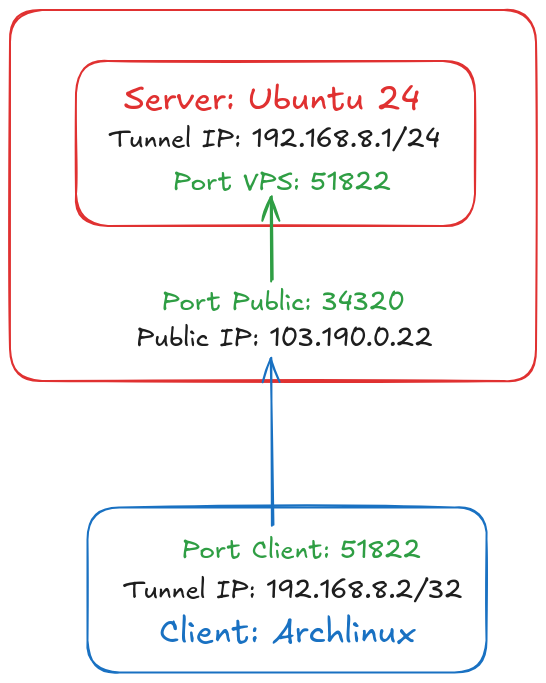
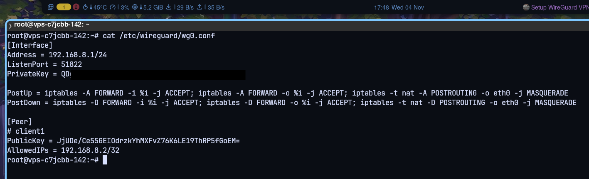
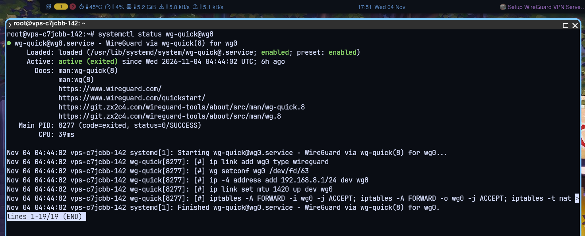
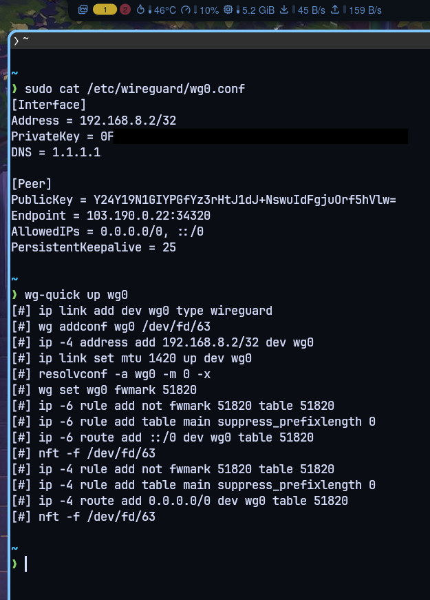
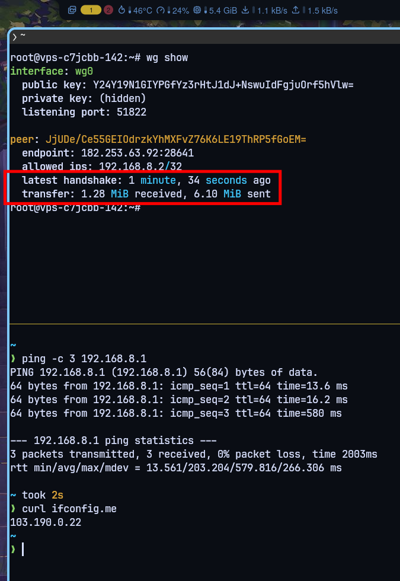

:::warning[AI Usage]

Most of these article contents are AI-assisted (Opencode with DeepSeek V4.1 Flash Free) and verified against the official WireGuard documentation.

:::

## About `wireguard`

WireGuard is an extremely simple yet fast and modern VPN that utilizes state-of-the-art cryptography. It aims to be faster, simpler, leaner, and more useful than IPsec, while avoiding the massive headache. It intends to be considerably more performant than OpenVPN.[^1]

Unlike OpenVPN, WireGuard has no certificates, no TLS handshake, and no long configuration files. Each peer is identified by a key pair, and the whole tunnel fits in a short `.conf` file. On Linux it runs as a kernel module, so it is also light on CPU.

:::info

WireGuard has no real "server" or "client" role — every side is a **peer**. In this article, "server" means the peer with a public IP that others connect to, and "client" means the peer behind NAT.

:::

## Scenario

| Role   | OS         | Public IP      | Tunnel IP        | Port Forwarding |
| ------ | ---------- | -------------- | ---------------- | --------------- |
| Server | Ubuntu 24  | `103.190.0.22` | `192.168.8.1/24` | 34320 -> 51822  |
| Client | Arch Linux | dynamic        | `192.168.8.2/32` |       -         |



The server routes the client's internet traffic (full tunnel). Replace the IPs, interface name, and port with your own values.

## Installation

::: code-group labels=[debian/ubuntu, archlinux]

```shell
sudo apt update
sudo apt install wireguard
```

```shell
sudo pacman -S wireguard-tools
```

:::

On most modern kernels the `wireguard` module is already included, so `wireguard-tools` is all you need for the `wg` and `wg-quick` commands.[^2]

:::note

If a config uses `DNS =` (recommended for clients), `wg-quick` needs a `resolvconf` provider to apply it. On Arch, install `openresolv` before starting the tunnel:

```shell
sudo pacman -S openresolv
```

:::

## Server setup

### 1. Generate the key pair

```shell
umask 077
wg genkey | tee server-private.key | wg pubkey > server-public.key
```

`umask 077` makes sure only the owner can read the private key. The official quick start uses the same pattern.[^3]

### 2. Create `/etc/wireguard/wg0.conf`

```ini
[Interface]
Address = 192.168.8.1/24
ListenPort = 51822
PrivateKey = <SERVER_PRIVATE_KEY>

PostUp = iptables -A FORWARD -i %i -j ACCEPT; iptables -A FORWARD -o %i -j ACCEPT; iptables -t nat -A POSTROUTING -o eth0 -j MASQUERADE
PostDown = iptables -D FORWARD -i %i -j ACCEPT; iptables -D FORWARD -o %i -j ACCEPT; iptables -t nat -D POSTROUTING -o eth0 -j MASQUERADE

[Peer]
# client1
PublicKey = <CLIENT_PUBLIC_KEY>
AllowedIPs = 192.168.8.2/32
```



Then restrict the file:

```shell
sudo chmod 600 /etc/wireguard/wg0.conf
```

:::warning

`eth0` is the **internet-facing** interface of the server, not the tunnel. Check yours with:

```shell
ip route get 1.1.1.1
```

The `PostUp`/`PostDown` rules above use `iptables`. If your server only ships `nftables`, translate them or install `iptables` first.

:::

### 3. Enable IP forwarding

```shell
echo "net.ipv4.ip_forward = 1" | sudo tee /etc/sysctl.d/99-wireguard.conf
sudo sysctl --system
```

Without forwarding, clients can reach the server but not the internet through it.

### 4. Open the UDP port

If you use UFW:

```shell
sudo ufw allow 51822/udp
```

If you use a cloud provider (AWS, GCP, Oracle, etc.), also allow `51820/udp` in its security group or firewall panel. This is the most common reason a tunnel never handshakes.

### 5. Start the tunnel

```shell
sudo systemctl enable --now wg-quick@wg0
```



The systemd unit brings the interface up and starts it on boot. For manual control, use `sudo wg-quick up wg0` and `sudo wg-quick down wg0` instead.

## Client setup

### 1. Generate the client keys

Generate them **on the client** so the private key never leaves the device:

```shell
umask 077
wg genkey | tee client-private.key | wg pubkey > client-public.key
cat client-public.key
```

Copy the printed public key into the server's `[Peer]` section.

### 2. Create `/etc/wireguard/wg0.conf`

```ini
[Interface]
Address = 192.168.8.2/32
PrivateKey = <CLIENT_PRIVATE_KEY>
DNS = 1.1.1.1

[Peer]
PublicKey = <SERVER_PUBLIC_KEY>
Endpoint = 203.0.113.10:51820
AllowedIPs = 0.0.0.0/0, ::/0
PersistentKeepalive = 25
```

`DNS =` makes `wg-quick` call `resolvconf` after bringing the interface up. If that command is missing, install `openresolv` first as described in [Installation](#installation).

### 3. Start the tunnel

```shell
sudo systemctl enable --now wg-quick@wg0
```



After editing the config later, apply the changes with `sudo systemctl restart wg-quick@wg0`.

:::tip[Split tunnel]

To route only the VPN subnet and keep normal traffic outside the tunnel, change `AllowedIPs` to:

```ini
AllowedIPs = 192.168.8.0/24
```

:::

:::note

`PersistentKeepalive = 25` keeps the NAT mapping alive when the client is behind a router. You do not need it on a server with a public IP.

:::

## Verify the tunnel

On the server:

```shell
sudo wg show
```

You should see a `peer` entry with a `latest handshake` line. Then test from the client:

```shell
ping -c 3 192.168.8.1
curl ifconfig.me
```

`curl` should return the server's public IP (`103.190.0.22`), which means the traffic is going through the tunnel. If the client's `wg show` has no handshake, check [Troubleshooting](#troubleshooting).



## Adding more peers

Repeat the client key generation, add one `[Peer]` block per device on the server, and give each one a unique `/32` address:

```ini
[Peer]
# laptop
PublicKey = <LAPTOP_PUBLIC_KEY>
AllowedIPs = 192.168.8.3/32
```

Apply the new config without dropping existing connections:

```shell
sudo wg syncconf wg0 <(sudo wg-quick strip wg0)
```

`wg syncconf` only reloads the configuration; it does not create or remove the interface.

## Optional: use an installer script

If you do not want to configure everything manually, [angristan/wireguard-install](https://github.com/angristan/wireguard-install) automates key generation, NAT, and client creation with an interactive menu:

```shell
curl -O https://raw.githubusercontent.com/angristan/wireguard-install/master/wireguard-install.sh
chmod +x wireguard-install.sh
sudo ./wireguard-install.sh
```

The result is the same as the manual setup above, just faster.

## Troubleshooting

- **No handshake**: the UDP port is blocked, the `Endpoint` is wrong, or the server is not running. Check `sudo wg show` on both sides and confirm the port with `sudo ss -ulnp | grep 51820`.
- **Connected but no internet**: IP forwarding is disabled, the `PostUp` NAT rule points to the wrong interface, or the provider firewall blocks forwarding.
- **Some websites hang or time out**: MTU is too high. Add `MTU = 1380` under `[Interface]` and restart the tunnel.
- **DNS leaks**: set `DNS =` in the client's `[Interface]` section. `wg-quick` writes it to `resolv.conf` automatically.
- **`resolvconf: command not found`** (systemd exit status 127): the client has no `resolvconf` provider. `wg-quick` creates the interface, fails on the DNS step, then deletes `wg0` again, so the tunnel never comes up. Install `openresolv` (`sudo pacman -S openresolv`) or `systemd-resolvconf`, then run `sudo systemctl restart wg-quick@wg0`.
- **`wg0 already exists`**: the interface is already up. Run `sudo wg-quick down wg0` before starting the systemd unit.
- **IPv6 errors**: if your server has no IPv6, remove `::/0` from `AllowedIPs`.

:::warning[Security]

- Keep private keys at `chmod 600` and never commit them to a repository.
- A `PresharedKey` is optional, but adds a symmetric layer for post-quantum resistance. Generate one per peer pair with `wg genpsk`.
- WireGuard is silent by default: a closed port looks like no service at all. That is normal, not a bug.

:::

[^1]: https://www.wireguard.com/
[^2]: https://wiki.archlinux.org/title/WireGuard
[^3]: https://www.wireguard.com/quickstart/
